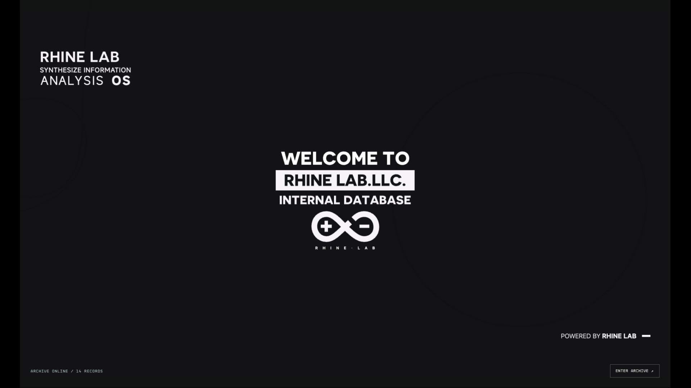
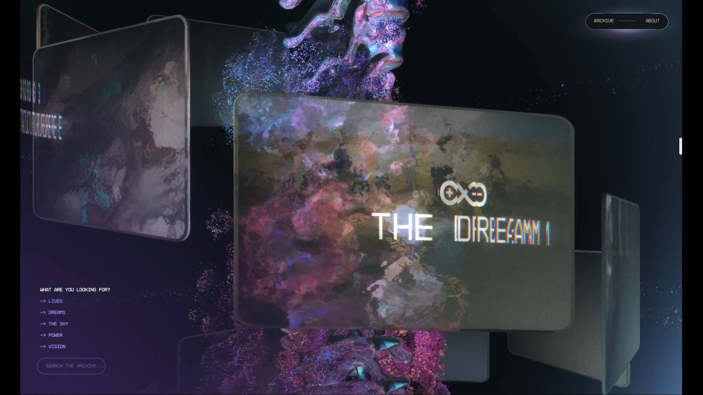
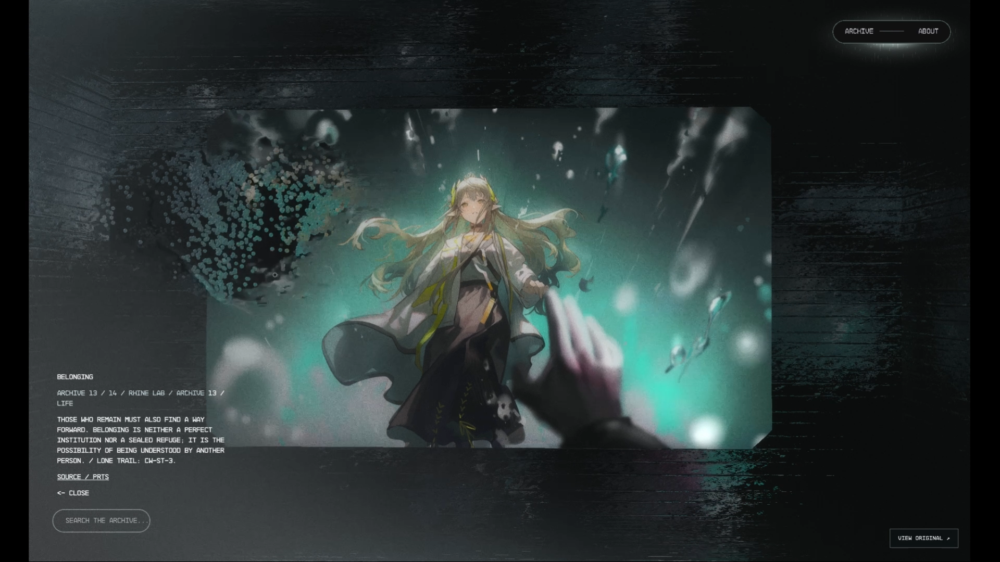

# RHINE LAB — The shape of a dream

以莱茵生命为主题的个人《明日方舟》交互艺术网站：十四幅 CG、实时三维场景、鼠标粒子交互，以及深色实验室登录开场。

**[访问网站](https://rhine.reverieach.com) · [项目仓库](https://github.com/reverieach/rhine-lab-art)**

基于 [open-active-theory](https://github.com/Snychng/open-active-theory) 的场景与动效进行内容适配，登录开场改编自 [RhineLabUI](https://github.com/LBEILC/RhineLabUI)。本项目为非官方同人艺术研究，与鹰角网络及 Active Theory 无隶属关系。源码公开不代表第三方 CG、音乐、字体与运行时获得统一开源授权，详见[来源与许可](#来源与许可)。

## 运行画面

以下画面来自当前网站的实际录制，保留原来的实时 WebGL 渲染。采集与素材说明见 [截图来源](docs/images/README.md)。





## 运行

需要 Node.js 24 或更新版本。

```sh
npm ci
npm run build
npm run dev
```

打开 http://localhost:4199/ 。修改源文件后重新 `npm run build`，刷新浏览器。`PORT=4200 npm run dev` 可指定端口。

## 展示与部署

项目需要 Node 服务来处理深链接、站内搜索和 WebSocket；不要只把 `public/` 当作完整服务部署。

- Ubuntu / Nginx / systemd 示例见 [部署说明](docs/DEPLOYMENT.md) 和 `deploy/`。
- [render.yaml](render.yaml) 是可选的 Render 部署模板；创建服务前自行核对平台当前套餐、配额与区域可达性。
- 本地服务默认监听所有网卡，便于局域网预览。仅本机访问可用 `HOST=127.0.0.1 npm run dev`。

仓库不包含服务器凭据、账户信息、备案资料、证书私钥或录屏成片。

## 已接入内容

- 登录：沿用 RhineLabUI 的标志笔画、身份提示、授权扫描、欢迎页逐帧动画；整体深色，止于欢迎页。主站真实资源就绪且欢迎帧停稳后，约 1.5 秒淡入原三维场景。就绪后可以跳到欢迎页；减少动态效果偏好会直接显示欢迎页。
- 标志：按 RhineLabUI 共享标志的贝塞尔轮廓生成三维挤出模型，替换首页、About、TreeScene、CleanRoom 所需几何和相关贴图。保留原始材质；CleanRoom 中缩小横向标志贴图，避免遮挡两侧文字。展品卡片贴图预留透明边距，避开原 LogoShader 左右各 10% 的裁切区，完整显示标志。
- 十四张 CG：全部为 PRTS 下载的 1600×900 原始 PNG，构建原样复制，不放大、不压缩。采用 01B / 02A / 03B；第 11 张为 CG-D《晨曦》。**无展示视频**。
- 原始特效：相机路径、场景顺序、滚动参数、GLSL、详情粒子与鼠标流体扰动继续使用原发布版。全屏模式显示完整 CG；正常展品详情仍走原来的实时图形渲染。
- 全英文页面与标题。十四段是主题性展陈，不是严格剧情时间顺序；文案为同人创作。《晨曦》明确来自 DV-8 BEG。
- 叙事顺序固定为 Origin → A Name → Fracture → The Dream → The Subjects → Awakening → Horizon → Intersection → Ascent → Parting → Daybreak → Farewell → Belonging → The Way Forward。

## 编辑入口

- `src/content.mjs`：顺序、英文文字、配色、标签、来源链接。
- `src/assets/rhine/01.png` 至 `14.png`：选定原图；`sources.json` 记录原始来源、尺寸与哈希。
- `src/rhine-shape.mjs`：莱茵生命三维轮廓生成。
- `src/boot/upstream/`：RhineLabUI 登录代码及 MIT 许可；`src/boot/entry.js` / `boot.css` / `bridge.html` 为接入与深色适配。
- `scripts/build.mjs`：内容适配、几何生成和原视觉基线校验。`public/` 为生成物与原站依赖资源。

## 验证

先启动服务，再运行 `npm run check`。它核验受保护模块、2577 项原始参数、shader、14 张原图尺寸与哈希、深链接、Range 与本地搜索。原仓库完整浏览器检查仍可用 `npm test`，记录输出到忽略目录 `.artifacts/`。本次另外使用桌面应用浏览器检查真实 WebGL 页面；桌面窄屏模拟不等于真实手机 GPU 验收。

主站音乐默认关闭。已移除 About 中无关的手机配对二维码、重复社交图标及原机构的聊天隐私提示。About 保留项目 GitHub、PRTS、鹰角官网与明日方舟官网；展品保留各自的 PRTS 原图来源链接。

## 隐私与贡献

提交前检查 `git diff --cached`，不要提交 `.env`、浏览器会话、云账户资料、私钥或部署备份；本地测试输出放在 `.artifacts/`。建议使用 GitHub 提供的 `noreply` 提交邮箱。安装 [Gitleaks](https://github.com/gitleaks/gitleaks) 后可运行 `gitleaks git . --log-opts="--all" --redact` 扫描历史；配置仅排除已核实的动画表达式误报。

发现疑似凭据时，请勿在公开 Issue 中粘贴原值；先通过 GitHub 私密漏洞报告联系维护者。

## 来源与许可

这是非官方个人研究。RhineLabUI 代码采用 MIT，复制部分保留原许可。其未随仓库分发的商业 Novecento Webfont 未下载；开场使用该项目自带固定字形图形和 MiSans。Active Theory 发布包及原站字体、音乐未被授予统一开源许可；《明日方舟》CG 与品牌标志也不因个人研究或 MIT 代码而成为自由授权素材。细目见 [THIRD_PARTY_NOTICES.md](THIRD_PARTY_NOTICES.md)。
